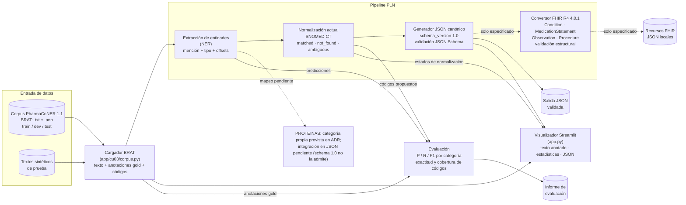

# Arquitectura de la solución — CU-03

Este documento describe la arquitectura del prototipo para la extracción y estructuración de información clínica en español mediante PLN: cómo se organizan las piezas que transforman un texto clínico en español en entidades estructuradas, normalizadas e interoperables. La arquitectura da soporte directo a las funcionalidades especificadas en los `specs/`.

## Visión general

El sistema es un **pipeline secuencial por etapas desacopladas**, donde cada etapa produce un artefacto verificable y evaluable de forma independiente:

1. **Entrada**: casos clínicos en español del corpus PharmaCoNER (formato BRAT) y textos sintéticos.
2. **Extracción (NER)**: detección y clasificación de menciones clínicas con sus offsets exactos.
3. **Normalización**: asociación de cada mención a códigos SNOMED CT / CIE-10-ES cuando la correspondencia es defendible.
4. **Salida JSON canónica**: consolidación final de texto, entidades y resultados de normalización en un documento validado contra el esquema 1.0.
5. **Conversión FHIR**: ampliación especificada, todavía no implementada, para representar el subconjunto mapeable como recursos HL7 FHIR.
6. **Evaluación**: métricas reproducibles (precisión, recall, F1, exactitud de códigos y cobertura) por etapa.

En paralelo, un **visualizador Streamlit** permite explorar el corpus y los resultados de cada etapa sin ejecutar el pipeline a mano.

## Diagrama de arquitectura

## Componentes

### Cargador de corpus (`app/cu03/corpus.py`)

- **Responsabilidad**: leer los archivos BRAT de PharmaCoNER (texto en `.txt`, anotaciones en `.ann`), unir cada mención con su offset de caracteres y su código SNOMED CT gold, y exponer el resultado como estructuras de Python por partición oficial (train / dev / test).
- **Recibe**: rutas a los directorios del corpus en formato BRAT.
- **Produce**: objetos `Document` con texto original, anotaciones (`Annotation`), etiquetas PharmaCoNER, offsets y códigos gold.
- Es el único componente que conoce el formato físico del corpus; el resto trabaja con objetos Python ya parseados. El parser BRAT está implementado y lo utiliza el visualizador y el pipeline.

### Extracción de entidades (NER)

- **Responsabilidad**: detectar menciones clínicas en texto libre en español y asignarles categoría (`drug`, `disease`, `symptom`, `procedure`, `protein`), conservando el texto original intacto y los offsets exactos. Especificado en [`specs/extraccion-entidades.md`](specs/extraccion-entidades.md).
- **Recibe**: texto en español (corpus público o sintético).
- **Produce**: lista de menciones con `text`, `type`, `start`, `end` y, si el método lo proporciona, confianza.
- La primera fase prioriza los fármacos. El extractor trabaja con las etiquetas originales de PharmaCoNER; en el mapeo actual a JSON 1.0, `NORMALIZABLES` y `NO_NORMALIZABLES` se convierten en `drug`, mientras que `PROTEINAS` y `UNCLEAR` se excluyen. La decisión de representar `PROTEINAS` como categoría independiente `protein` está documentada en [`decisions/proteinas-categoria-propia.md`](decisions/proteinas-categoria-propia.md), pero todavía no está integrada en el esquema ni en el pipeline actuales.
- **Enfoque técnico**: detección basada en **diccionario y reglas**, con el diccionario construido a partir de las anotaciones gold de las particiones de entrenamiento y reglas deterministas de coincidencia sobre el texto original. La decisión, sus alternativas (modelos NER aprendidos, LLM, reglas morfológicas) y sus consecuencias se documentan en [`decisions/ner-diccionario-reglas.md`](decisions/ner-diccionario-reglas.md).
- **Limitación principal**: solo se reconocen los términos y variantes incluidos en el diccionario, las formas no contempladas no se detectan. Esto fija un techo de recall igual a la cobertura léxica del diccionario sobre la partición evaluada, que se debe reportar.

### Normalización terminológica

- **Responsabilidad**: asociar cada entidad detectada a un código SNOMED CT o CIE-10-ES cuando exista correspondencia inequívoca, y etiquetar explícitamente los casos no resueltos. Especificado en [`specs/normalizacion-clinica.md`](specs/normalizacion-clinica.md).
- **Recibe**: entidades extraídas + recursos de mapeo (correspondencias de los datasets, recursos terminológicos autorizados).
- **Produce**: un `NormalizationResult` por mención, con `coding` y estado `matched`, `not_found` o `ambiguous`.
- El normalizador actual realiza coincidencia exacta de la forma tokenizada y aplica `min_agreement` a la proporción del código más frecuente. No utiliza similitud textual difusa.
- La ADR de proteínas establece que `protein` debe quedar fuera de la normalización y usar `not_applicable`; sin embargo, el `Pipeline.normalize()` actual procesa todas las menciones antes de que el constructor del JSON filtre las etiquetas no admitidas. Esta integración está pendiente y no debe considerarse implementada.

### Generador de JSON canónico

- **Responsabilidad**: consolidar texto original, entidades y resultados de normalización en un único documento JSON conforme al esquema versionado (`schema_version`). Especificado en [`specs/generacion-json.md`](specs/generacion-json.md).
- **Recibe**: texto original, entidades extraídas, resultados de normalización.
- **Produce**: documento JSON final validable (UTF-8, offsets coherentes y valores permitidos acotados).
- El pipeline no intercambia literalmente un JSON entre cada etapa: NER y normalización utilizan estructuras Python (`Mention`, `NormalizationResult` y diccionarios). El JSON se construye al final, se valida contra el esquema 1.0 y constituye la representación persistente/de intercambio para consumidores posteriores. La salida FHIR, cuando se implemente, deberá generarse a partir de ese JSON validado.

### Conversor FHIR

- **Responsabilidad**: transformar el subconjunto mapeable del JSON canónico en recursos HL7 FHIR R4 (4.0.1) (`Condition` para enfermedades, `MedicationStatement` para fármacos, `Observation` para síntomas/signos y `Procedure` para procedimientos) y validarlos estructuralmente con el validador oficial de HL7. Especificado en [`specs/generacion-fhir.md`](specs/generacion-fhir.md).
- **Recibe**: JSON canónico validado.
- **Produce**: archivos FHIR JSON locales e informe de validación, los elementos no representables se informan como tales sin fabricar datos. Las entidades `protein` no se convierten.
- Es una ampliación, se aborda solo cuando el camino crítico (fármacos --> detección --> normalización --> JSON --> métricas) funciona de punta a punta.

### Evaluación

- **Responsabilidad**: ejecutar el pipeline sobre las particiones del corpus y producir un informe reproducible con métricas por etapa: precisión, recall y F1 (globales y por categoría) para extracción, exactitud top-1 y cobertura para normalización, validez de esquema para JSON y validez estructural para FHIR. Especificado en [`specs/evaluacion-resultados.md`](specs/evaluacion-resultados.md).
- **Recibe**: particiones del corpus con anotaciones gold y las salidas de cada etapa.
- **Produce**: informe con configuración completa (corpus, versión, partición, modelo, semilla, fecha) y limitaciones observadas.
- El conjunto de test se usa solo en la evaluación final, nunca para entrenar ni seleccionar hiperparámetros.

### Visualizador Streamlit (`app.py`)

- **Responsabilidad**: interfaz de exploración del corpus y de los resultados: visor de casos clínicos con menciones resaltadas por categoría y enlazadas a su código SNOMED CT, estadísticas del corpus (distribución por categoría y partición, fármacos y códigos más frecuentes) e inspector del JSON canónico.
- **Recibe**: la salida del cargador BRAT para explorar documentos y anotaciones; además, el tab de demostración utiliza el pipeline para procesar texto sintético introducido por el usuario.
- **Produce**: interfaz web local. No entrena ni modifica los componentes del pipeline; permite explorar el corpus, visualizar predicciones y consultar resultados.

## Mapeo a módulos de código real

La arquitectura descrita en este documento corresponde a la implementación actual del proyecto dentro de la carpeta `app/`.

| Bloque arquitectónico | Módulo real | Responsable | Observación |
|---|---|---|---|
| Ingesta y carga del corpus | `app/cu03/corpus.py` | carga BRAT + preparación de documentos | devuelve objetos `Document` con anotaciones, etiquetas y offsets |
| NER / extracción | `app/cu03/ner.py` | detección de entidades y puntuación | extrae menciones con tipo y confianza |
| Normalización terminológica | `app/cu03/normalization.py` | asignación de códigos a entidades | mantiene estados `matched`, `not_found`, `ambiguous` |
| JSON canónico | `app/cu03/schema.py` + `app/cu03/pipeline.py` | construcción y validación del documento final | esquema actual 1.0; no admite `protein` ni `not_applicable` |
| Evaluación | `app/cu03/evaluation.py` | métricas de extracción y normalización | compara predicciones con gold |
| Orquestación del pipeline | `app/cu03/pipeline.py` | encadena extracción → normalización → JSON | punto central de procesamiento |
| Ejecución de scripts | `app/scripts/run_pipeline.py`, `app/scripts/evaluate.py` | entradas CLI y flujo reproducible | útiles para uso del proyecto y automatización |
| Visualización | `app/app.py` | exploración del corpus y del pipeline | no forma parte del flujo crítico de procesamiento |

La relación entre los bloques de arquitectura y el código real es, por tanto, directa: el diagrama no es un esquema abstracto, sino una vista de la estructura operativa del repositorio actual.

## Flujo end-to-end

1. **Ingesta**: el cargador lee los archivos BRAT de PharmaCoNER (o un texto sintético de prueba) y produce el documento con texto y, si existe, anotación gold.
2. **Extracción**: el componente NER recibe el texto y devuelve las menciones detectadas con categoría y offsets. El texto no se modifica, de modo que `texto[start:end]` siempre coincide con la mención.
3. **Normalización**: el pipeline actual aplica el normalizador de coincidencia exacta a las menciones detectadas y obtiene `matched`, `not_found` o `ambiguous`. La exclusión de proteínas de esta etapa está definida como decisión, pero aún requiere implementarse: actualmente `Pipeline.normalize()` procesa todas las menciones. Una entidad no normalizada no debe desaparecer de la salida.
4. **JSON canónico**: el generador consolida texto, entidades y resultados de normalización en un documento con `schema_version: 1.0`, `language`, `source_text` y `entities`, y lo valida contra el esquema. Es la salida común del pipeline; no es el formato interno obligatorio de cada llamada entre componentes.
5. **FHIR (ampliación pendiente)**: la especificación prevé que un conversor tome el JSON canónico y genere recursos FHIR del subconjunto mapeable, validándolos estructuralmente y marcando lo no representable sin inventar datos. Esta conversión todavía no está implementada.
6. **Evaluación**: en paralelo, el evaluador compara las salidas de extracción y normalización con las anotaciones gold del corpus y produce el informe de métricas.

En todo momento el visualizador Streamlit permite inspeccionar cualquier documento del corpus con sus menciones, códigos y JSON canónico, lo que facilita el análisis cualitativo de errores que alimenta las mejoras del pipeline.

## Estado de implementación

| Componente | Estado | Evidencia de implementación |
|---|---|---|
| Cargador BRAT + visualizador Streamlit | Implementados; exploración y demostración local | `app/cu03/corpus.py`, `app/app.py` |
| Extracción (NER) | Implementada como gazetteer/diccionario con reglas | `app/cu03/ner.py` |
| Normalización | Implementada para las menciones que procesa el pipeline | `app/cu03/normalization.py` |
| Generador JSON canónico | Implementado con esquema 1.0 | `app/cu03/schema.py`, `app/cu03/pipeline.py` |
| Categoría `protein` independiente | Decidida en ADR, pero pendiente de integración en NER/pipeline/esquema | `decisions/proteinas-categoria-propia.md`; el esquema actual excluye `PROTEINAS` |
| Conversor FHIR | Especificado como ampliación; no implementado | `specs/generacion-fhir.md` |
| Evaluación | Implementada con métricas reproducibles | `app/cu03/evaluation.py`, `app/scripts/evaluate.py` |

La arquitectura refleja, por tanto, el estado real del proyecto: algunos bloques están implementados de forma funcional, mientras que otros siguen siendo ampliaciones o especificaciones que se ejecutarán después del camino crítico.

## Decisiones clave

Las decisiones de implementación que dan forma a esta arquitectura están documentadas como ADRs en `decisions/`:

| ADR | Decisión | Componente afectado |
|---|---|---|
| [`corpus-pharmaconer-brat.md`](decisions/corpus-pharmaconer-brat.md) | Corpus inicial PharmaCoNER en formato BRAT, fármacos como camino crítico | Cargador de corpus |
| [`estrategia-particiones-evaluacion.md`](decisions/estrategia-particiones-evaluacion.md) | Uso de las particiones oficiales train / dev / test | NER, normalización y evaluación |
| [`ner-diccionario-reglas.md`](decisions/ner-diccionario-reglas.md) | Detección de entidades farmacológicas mediante diccionario y reglas | Extracción (NER) |
| [`normalizacion-conservadora.md`](decisions/normalizacion-conservadora.md) | Normalización conservadora con estados explícitos | Normalización |
| [`pipeline-json-canonico.md`](decisions/pipeline-json-canonico.md) | Pipeline por etapas desacopladas con JSON canónico como contrato | Todo el pipeline |
| [`proteinas-categoria-propia.md`](decisions/proteinas-categoria-propia.md) | Proteínas como categoría propia `protein`, fuera de la normalización y de FHIR | NER, normalización, JSON, FHIR y evaluación |
| [`visualizador-streamlit.md`](decisions/visualizador-streamlit.md) | Visualizador de corpus y resultados con Streamlit | Visualizador |