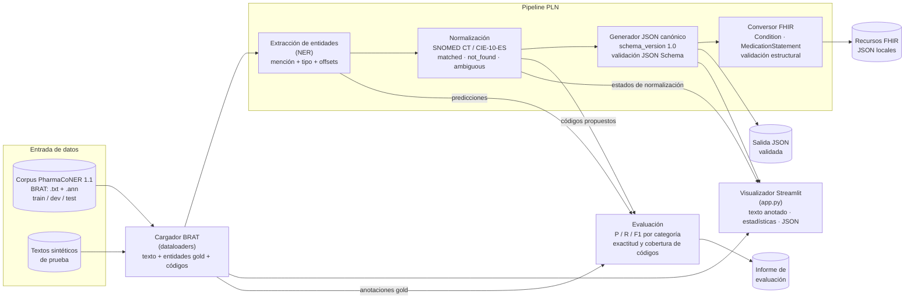

# Arquitectura de la solución — CU-03

Este documento describe la arquitectura del prototipo de PLN clínico para CU-03: cómo se organizan las piezas que transforman un texto clínico en español en entidades estructuradas, normalizadas e interoperables. La arquitectura da soporte directo a las funcionalidades especificadas en `specs/`.

## Visión general

El sistema es un **pipeline secuencial por etapas desacopladas**, donde cada etapa produce un artefacto verificable y evaluable de forma independiente:

1. **Entrada**: casos clínicos en español del corpus PharmaCoNER (formato BRAT) y textos sintéticos.
2. **Extracción (NER)**: detección y clasificación de menciones clínicas con sus offsets exactos.
3. **Normalización**: asociación de cada mención a códigos SNOMED CT / CIE-10-ES cuando la correspondencia es defendible.
4. **Salida JSON canónica**: consolidación de texto, entidades y códigos en un documento validado contra un esquema versionado.
5. **Conversión FHIR**: representación del subconjunto mapeable como recursos HL7 FHIR validados estructuralmente.
6. **Evaluación**: métricas reproducibles (precisión, recall, F1, exactitud de códigos, cobertura) por etapa.

En paralelo, un **visualizador Streamlit** permite explorar el corpus y los resultados de cada etapa sin ejecutar el pipeline a mano.

## Diagrama de arquitectura

## Componentes

### Cargador de corpus (`dataloaders`)

- **Responsabilidad**: leer los archivos BRAT de PharmaCoNER (texto en `.txt`, anotaciones en `.ann`), unir cada mención con su offset de caracteres y su código SNOMED CT gold, y exponer el resultado como estructuras de Python por partición oficial (train / dev / test).
- **Recibe**: rutas a los directorios del corpus en formato BRAT.
- **Produce**: documentos con texto original, lista de entidades (texto, categoría, `start`, `end`, código) y estadísticas agregadas.
- **Notas**: es el único componente que conoce el formato físico del corpus, el resto del sistema trabaja con estructuras ya parseadas. El parser BRAT está ya implementado y en uso por el visualizador.

### Extracción de entidades (NER)

- **Responsabilidad**: detectar menciones clínicas en texto libre en español y asignarles categoría (`drug`, `disease`, `symptom`, `procedure`), conservando el texto original intacto y los offsets exactos. Especificado en [`specs/extraccion-entidades.md`](specs/extraccion-entidades.md).
- **Recibe**: texto en español (corpus público o sintético).
- **Produce**: lista de menciones con `text`, `type`, `start`, `end` y, si el método lo proporciona, confianza.
- **Notas**: la primera fase prioriza fármacos con PharmaCoNER. El enfoque técnico concreto (modelo preentrenado, reglas, ajuste fino) se fijará tras inspeccionar los datos y se documentará en un ADR antes de implementar.

### Normalización terminológica

- **Responsabilidad**: asociar cada entidad detectada a un código SNOMED CT o CIE-10-ES cuando exista correspondencia inequívoca, y etiquetar explícitamente los casos no resueltos. Especificado en [`specs/normalizacion-clinica.md`](specs/normalizacion-clinica.md).
- **Recibe**: entidades extraídas + recursos de mapeo (correspondencias de los datasets, recursos terminológicos autorizados).
- **Produce**: para cada entidad, un bloque `coding` (sistema, código, display) y un `normalization_status` (`matched`, `not_found`, `ambiguous`).
- **Notas**: no se inventan códigos, los casos sin correspondencia se conservan con estado explícito. Es la etapa de mayor riesgo del proyecto y por eso se aborda pronto en el camino crítico.

### Generador de JSON canónico

- **Responsabilidad**: consolidar texto original, entidades y resultados de normalización en un único documento JSON conforme al esquema versionado (`schema_version`). Especificado en [`specs/generacion-json.md`](specs/generacion-json.md).
- **Recibe**: texto original, entidades extraídas, resultados de normalización.
- **Produce**: documento JSON validable (UTF-8, offsets coherentes, valores permitidos acotados), único contrato de datos entre etapas.
- **Notas**: el JSON es la representación canónica del prototipo, la salida FHIR se genera a partir de él, nunca en paralelo.

### Conversor FHIR

- **Responsabilidad**: transformar el subconjunto mapeable del JSON canónico en recursos HL7 FHIR (p. ej. `Condition`, `MedicationStatement`) y validarlos estructuralmente contra la versión de FHIR que se declare. Especificado en [`specs/generacion-fhir.md`](specs/generacion-fhir.md).
- **Recibe**: JSON canónico validado.
- **Produce**: archivos FHIR JSON locales e informe de validación, los elementos no representables se informan como tales sin fabricar datos.
- **Notas**: es una ampliación, se aborda solo cuando el camino crítico (fármacos → detección → normalización → JSON → métricas) funciona de punta a punta.

### Evaluación

- **Responsabilidad**: ejecutar el pipeline sobre las particiones del corpus y producir un informe reproducible con métricas por etapa: precisión, recall y F1 (globales y por categoría) para extracción, exactitud top-1 y cobertura para normalización, validez de esquema para JSON y validez estructural para FHIR. Especificado en [`specs/evaluacion-resultados.md`](specs/evaluacion-resultados.md).
- **Recibe**: particiones del corpus con anotaciones gold y las salidas de cada etapa.
- **Produce**: informe con configuración completa (corpus, versión, partición, modelo, semilla, fecha) y limitaciones observadas.
- **Notas**: el conjunto de test se usa solo en la evaluación final, nunca para entrenar ni seleccionar hiperparámetros.

### Visualizador Streamlit (`app.py`)

- **Responsabilidad**: interfaz de exploración del corpus y de los resultados: visor de casos clínicos con menciones resaltadas por categoría y enlazadas a su código SNOMED CT, estadísticas del corpus (distribución por categoría y partición, fármacos y códigos más frecuentes) e inspector del JSON canónico.
- **Recibe**: la salida del cargador BRAT y, a medida que se implementen, los resultados de NER y normalización.
- **Produce**: interfaz web local, no forma parte del camino de procesamiento, solo de la exploración y demostración.

## Flujo end-to-end

1. **Ingesta**: el cargador lee los archivos BRAT de PharmaCoNER (o un texto sintético de prueba) y produce el documento con texto y, si existe, anotación gold.
2. **Extracción**: el componente NER recibe el texto y devuelve las menciones detectadas con categoría y offsets. El texto no se modifica, de modo que `texto[start:end]` siempre coincide con la mención.
3. **Normalización**: cada mención pasa por el normalizador, que intenta asociarle un código de SNOMED CT / CIE-10-ES y, en cualquier caso, emite un estado (`matched` / `not_found` / `ambiguous`). Una entidad sin código no desaparece del flujo.
4. **JSON canónico**: el generador consolida texto, entidades y códigos en el documento JSON con `schema_version`, `language`, `source_text` y `entities`, y lo valida contra el esquema. Este documento es el contrato entre todas las etapas posteriores.
5. **FHIR**: el conversor toma el JSON canónico y genera los recursos FHIR del subconjunto mapeable, validándolos estructuralmente, lo no representable se informa, no se inventa.
6. **Evaluación**: en paralelo, el evaluador compara las salidas de extracción y normalización con las anotaciones gold del corpus y produce el informe de métricas.

En todo momento el visualizador Streamlit permite inspeccionar cualquier documento del corpus con sus menciones, códigos y JSON canónico, lo que facilita el análisis cualitativo de errores que alimenta las mejoras del pipeline.

## Estado de implementación

| Componente | Estado |
|---|---|
| Cargador BRAT + visualizador Streamlit | Implementado y operativo |
| Extracción (NER) | Especificado, enfoque técnico pendiente de ADR |
| Normalización | Especificado, camino crítico prioritario |
| Generador JSON canónico | Especificado (contrato ya definido en `specs/generacion-json.md`) |
| Conversor FHIR | Especificado, ampliación tras el camino crítico |
| Evaluación | Especificado, se ejecutará sobre las particiones oficiales |

## Decisiones clave

Las decisiones de implementación que dan forma a esta arquitectura están documentadas como ADRs en `decisions/`: